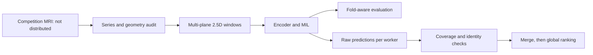

# Knee MRI: validation, computer vision and reliable inference

**A Data Science / Computer Vision case study by [Décimus Tavares](https://github.com/10cimux).**

Predicting 12 abnormalities from multi-planar knee MRI in the
[RSNA 2026 Kaggle competition](https://www.kaggle.com/competitions/rsna-knee-abnormality-detection).
The central challenge was reliable evaluation with only **58 fully annotated studies**.

## Results and authorship

| Work | Result | What the number establishes |
|---|---:|---|
| EXP04: project-developed ResNet18 2.5D pipeline | 0.632989 OOF; **0.732 public** | Five-fold local validation; accepted submission reported by the participant |
| EXP06: fixed 50/50 blend | 0.648303 OOF | Observed gain; paired 95% interval includes zero |
| EXP08: frozen ConvNeXt + finding-specific attention | 0.600201 OOF | Failed to improve the baseline; experiment closed |
| EXP10: attributed reproduction of public Raptor | **0.924 public** | Accepted submission reported by the participant; pretrained model belongs to its original author |
| EXP12: two-GPU execution of the EXP10 recipe | Exact parity in the executed pilot and visible test | **Not submitted before the deadline; no official EXP12 score** |

The public scores are not private leaderboard scores or evidence of clinical performance.
Raptor is by **Dread Development / Johnathan Wagner**. The improvement from 0.732 to
0.924 involved adopting that public model, not training an original model of equivalent performance.
The project was developed with AI-assisted coding; experimental decisions and evidence are documented.

## What this project demonstrates

- **Statistical evaluation:** distinguish global OOF AUC from mean fold AUC, decompose
  within-fold and between-fold ranking pairs, preserve negative experiments.
- **Computer vision:** multi-planar 2.5D MRI, physical-scale preprocessing audits,
  frozen-encoder MIL, plane/position embeddings and finding-specific attention.
- **Reproducibility:** version and hash checks, fixed label order, unknown-label masks,
  checkpoint round trips, synthetic regression tests.
- **Inference engineering:** study-level parallelism, complete-coverage checks, global
  ranking after merging shards, runtime budgeting and prediction-equivalence gates.

## Run the public, data-free demonstration

Python 3.11+; no GPU, Kaggle account, MRI data or weights required.

```bash
python -m pip install -e .
python -m knee_portfolio.demo
python -m unittest discover -s tests -v
```

Optional real PyTorch head tests (synthetic features, no model training):

```bash
python -m pip install -e ".[vision]"
python -m unittest discover -s tests_vision -v
```

The demo deliberately creates a synthetic case where every fold ranks perfectly
but the global ranking is weaker. It also verifies serial/sharded ranking parity.
It does not run MRI inference or create a competition submission.

## Explore the case study

- [Executed synthetic notebook](notebooks/01_validation_case_study.ipynb).
- [Experiment ledger](docs/experiments.md): early failures through EXP12.
- [Technical case study](docs/case-study.md): hypotheses, evidence and trade-offs.
- [Post-competition research](docs/research-2026-10-26.md): official sources and available write-ups.
- [Reproduction boundaries](docs/reproducibility.md): what runs here and what requires restricted inputs.
- [Provenance and licences](docs/provenance.md).
- [Portuguese overview](docs/RESUMO_PT.md).



## Scope

This is a curated portfolio release, not the complete private competition workspace.
It includes executable evaluation utilities, the original EXP08 head module and a
data-free extraction of the EXP12 orchestration contracts. MRI files, clinical
reports, real study identifiers, target tables, predictions and checkpoints are excluded.
The competition workspace and all historical artifacts remain preserved separately.
Research software only; no clinical validation or deployment claim.
